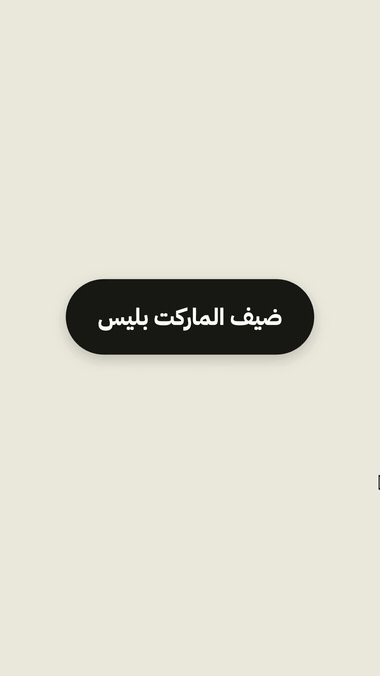

# بلقنات ماجد الزعابي

مكان واحد لكل البلقنات. تضيفه مرة وحدة، وأي تحديث يوصلك لحاله.

| البلقن | شنو فيه |
|---|---|
| [`content-engine-v5`](content-engine) | مصنع المحتوى: هويتك، لوحة أخبار، كاروسيل بغلاف مصمم من الخبر، تعريب بوستات انستقرام، نشر بأمر واحد عبر بلوتاتو، ووكلاء: استوديو إعلان المنتجات ومدير الجودة. (مو المنصة الكاملة — هذي أدوات الكاروسيل والنشر بس.) |
| `majed-video` | 6 سكلات فيديو: ريل من فيديو كلام، موشن 3D، بودكاست، مونتاج على الإيقاع، أغلفة وثمبنيل، ودافنشي ريزولف. المصدر: [majedphotos/video-ad-editor](https://github.com/majedphotos/video-ad-editor). |
| [`majed-live-stage`](live-stage) | شاشة العرض الحي: عرض يمشي بصوتك، المشاهد تطلع لما تقول عباراتها، وهايكو يرسم وأنت تتكلم، وتصويت الجمهور بالباركود. ومعه سكل يبني العرض ويفحصه. |

## التثبيت

<p align="center"></p>

**من claude.ai أو تطبيق الديسكتوب** (يوصل الويب والديسكتوب والجوال):
1. Customize ← Plugins ← Add ← Add marketplace
2. اكتب: `majedphotos/majed-plugins`
3. فعّل **Sync automatically**، وأضف البلقن اللي تبيه.

**من الطرفية (Claude Code):**
```bash
claude plugin marketplace add majedphotos/majed-plugins
claude plugin install content-engine-v5@majed-plugins
claude plugin install majed-video@majed-plugins
claude plugin install majed-live-stage@majed-plugins
```

## ملاحظات
- المهارات والأوامر تظهر بكل التطبيقات. الوكلاء (agents) تشتغل بـCowork وClaude Code بس.
- شاشة العرض الحي تحتاج لابتوب فيه كروم وبايثون، وكلود كود مسجّل دخول عشان هايكو.
- رسم الفيديو (ffmpeg، كروم، دافنشي) يحتاج جهاز. على الجوال يقرا التعليمات ويستخدم بدائل السحابة حسب سكل الفيديو.
- التحديث: كل نسخة جديدة لازم يرتفع رقمها بـ`plugin.json` (وإلا ما يوصل أحد التحديث).
