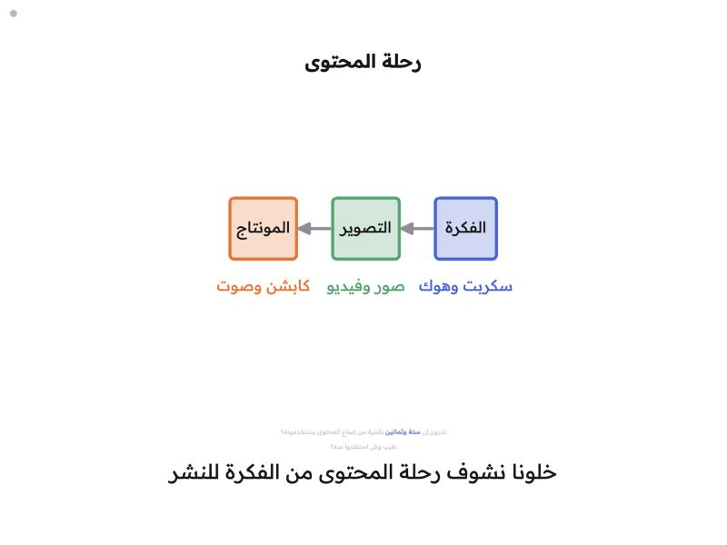
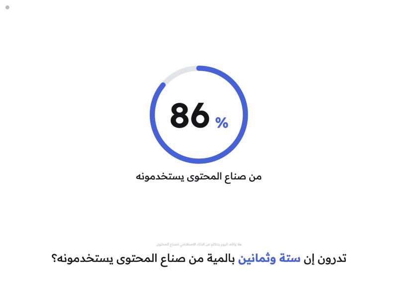
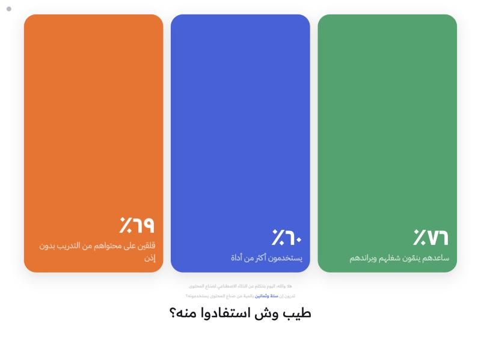
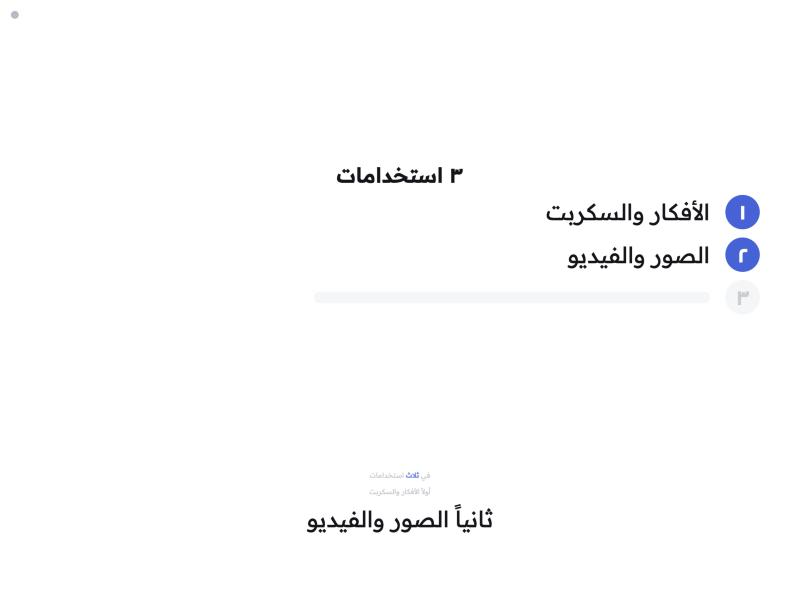
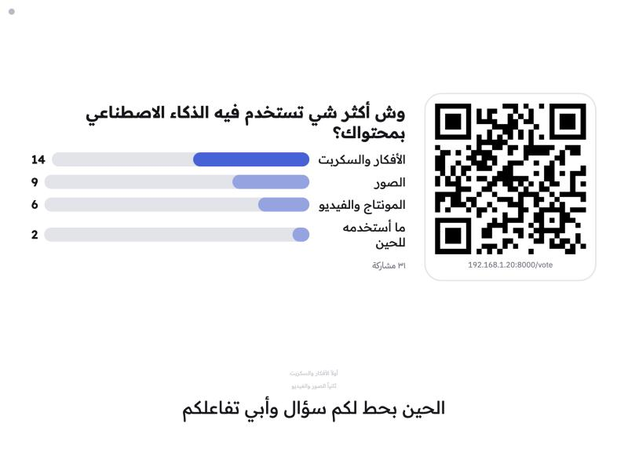
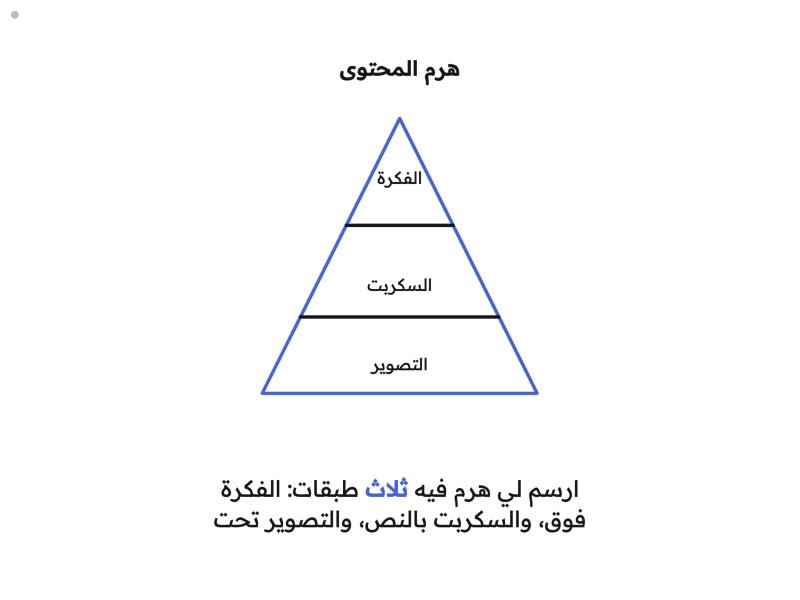

# شاشة العرض الحي · Live Stage

[العربية](#العربية) · [English](#english)

**التنصيب ككلود بلقن / Install as a Claude Code plugin:**

```
/plugin marketplace add majedphotos/majed-plugins
/plugin install majed-live-stage@majed-plugins
```

بعدها قول لكلود "أبي عرض عن ..." / Then ask Claude for "a live presentation about ...".

<p align="center"></p>

---

<div dir="rtl">

## العربية

شاشة عرض تمشي بصوتك. تتكلم عادي، والصفحة تكتب كلامك وتطلّع الرسمة الجاهزة لما تقول عبارة المشهد. ولو طلبت شي مو موجود ("طلّع لهم ثلاث بطاقات"، "ارسم سهم من هنا لهناك")، كلود هايكو يرسمه وأنت تتكلم.

### وش تسوي
- **مشاهد جاهزة بالصوت:** كل مشهد في `deck.json` له عبارات، تقولها فيطلع.
- **رسم مرتجل:** عدادات، قوائم، بطاقات، مقارنات، خط زمني، كلمة، ورسم حر (`sketch`)، عن طريق كلود هايكو باشتراكك في Claude Code.
- **تصويت الجمهور بالباركود:** يصوّرون الباركود ويصوّتون من جوالاتهم، والنتيجة تطلع على الشاشة.
- **الرجوع بالصوت:** "خلونا نرجع لـ..." يرجعك لمشهد سابق.
- **تسخين:** أول جلسة مع هايكو تنفتح لما يتحمّل العرض، عشان أول رسمة ما تتأخر.
- **ريموت احتياطي:** الأسهم أو الكليكر. وطقتين على المايك نفسه (مثلاً مايك وايرلس على صدرك) تمسح الشاشة، والصفحة تفرّق بين الطقة وكلامك.

### أمثلة

كل صورة تحت طلعت من جملة وحدة قالها المتحدث. الجمل من عرض «الذكاء الاصطناعي لصناع المحتوى» الموجود في [`decks/ai-for-creators.json`](decks/ai-for-creators.json)، والكلمات العريضة هي عبارة المشهد.

| تقول | يطلع على الشاشة |
|---|---|
| «هلا والله، اليوم بنتكلم عن الذكاء الاصطناعي **لصناع المحتوى**» |  |
| «تدرون إن **ستة وثمانين** بالمية من صناع المحتوى يستخدمونه؟» |  |
| «طيب **وش استفادوا** منه؟» |  |
| «خلونا نشوف **رحلة المحتوى** من الفكرة للنشر» |  |
| «في **ثلاث استخدامات**» ثم «أولاً…» و«ثانياً…» |  |
| «الحين **بحط لكم سؤال** وأبي تفاعلكم» |  |
| «ارسم لي هرم فيه ثلاث طبقات: الفكرة فوق، والسكربت بالنص، والتصوير تحت» |  |

- **آخر صورة مو مجهزة في العرض:** هايكو رسمها من الجملة نفسها خلال ثواني. نفس الشي لو قلت «طلّع لهم أربع بطاقات عن…» أو «قارن بين…».
- **أرقام التصويت في الصورة** أصوات تجريبية، والعنوان تحت الباركود مثال. وقت العرض يطلع عنوان جهازك.
- **أرقام العداد والبطاقات** من [تقرير أدوبي للمبدعين (أكتوبر ٢٠٢٥)](https://news.adobe.com/news/2025/10/adobe-max-2025-creators-survey).

### التشغيل في ٣ خطوات
1. سجّل دخول Claude Code مرة وحدة: شغّل `claude` في الترمنال واكتب `/login`.
2. داخل هالمجلد شغّل:
   ```bash
   python3 server.py
   ```
   (منفذ ثاني: `python3 server.py 8010`)
3. افتح **كروم** على `http://localhost:8000`، اضغط "ابدأ الاستماع" واسمح للمايك.

لا تفتح الملف بدبل كليك. المايك والتصويت يحتاجون السيرفر.

### العروض وعبارات التشغيل
- الصفحة تقرا `deck.json` اللي جنبها. فيه نسخة من عرض مثال، وفي `decks/` عرضين: `ai-for-creators.json` و`phone-photography.json`. انسخ اللي تبيه فوق `deck.json` وحدّث الصفحة.
- كل مشهد فيه `say` (العبارات اللي تفتحه)، و`show` (الرسمة)، و`talk` (نقاط كلامك، ما تطلع للجمهور).
- الصفحة تسمع بس عبارات المشاهد الثلاثة الجاية. القفز فوق مشهد يحتاج عبارة من كلمتين أو أكثر.
- `speaker` و`dialect` اختيارية: اسمك ولهجتك عشان هايكو يعرف مين يتكلم. بدونها يقول "المتحدث" بلهجة كويتية.
- الشكل الكامل في [`skill/live-stage-deck/references/deck-format.md`](skill/live-stage-deck/references/deck-format.md).
- افحص أي عرض قبل ما تقدمه. المدقق يشغّل كود المطابقة من الصفحة نفسها:
  ```bash
  node skill/live-stage-deck/scripts/validate_deck.mjs deck.json
  ```

### سكل Claude Code (اختياري)
`skill/live-stage-deck/` سكل يبني لك `deck.json` من موضوع أو ملاحظات أو بوربوينت، ويفحصه ويطلّع ورقة متحدث. انسخه لـ `~/.claude/skills/live-stage-deck/`، وقول لكلود مكان هالمجلد أو حط `LIVE_STAGE_DIR`.

### التصويت
جوالات الجمهور **لازم تكون على نفس الواي فاي** اللي عليه اللابتوب. بعض شبكات القاعات تمنع الأجهزة توصل لبعض، فجرّب قبل العرض، ولو ما زبطت شغّل هوت سبوت. الفهم الذكي وفتح التصويت مسموحين بس من نفس الجهاز.

### حدود معروفة
- التعرف على الكلام يشتغل على **كروم بس** (Web Speech API).
- دقة التعرف على **اللهجة الكويتية** ما هي مضمونة. جرّب بصوتك قبل العرض.
- الرسم المرتجل ياخذ تقريباً **١ إلى ٢.٥ ثانية** لكل رسمة. المشاهد الجاهزة فورية.
- يحتاج Claude Code مسجّل دخول (`claude` في الـ PATH)، ونت.
- بديل بدون Claude Code: تقدر تحط مفتاح Anthropic API في إعدادات "فهم ذكي". المفتاح ينحفظ في متصفحك بس (localStorage) ويروح مباشرة لـ api.anthropic.com، فاستخدمه على جهازك الشخصي بس.
- الباركود يحتاج نت أول مرة عشان تتحمّل مكتبته.

### شكر وأعمال قريبة
فكرة المادة المرجعية للعرض، والتسخين، والرجوع بالصوت، مستلهمة من [kunchenguid/autopreso](https://github.com/kunchenguid/autopreso) و[Dave861/Lantr](https://github.com/Dave861/Lantr).

</div>

---

## English

A whiteboard that follows your voice. You talk normally; the page transcribes you and fires a prepared scene when you say its trigger phrase. Ask for something that isn't prepared ("show three cards", "draw an arrow from here to there") and Claude Haiku draws it while you keep talking. Built for Arabic (Kuwaiti dialect) talks.

### What it does
- **Voice-triggered scenes** from `deck.json`: each scene has phrases; say one and it appears.
- **Improvised drawings**: counters, lists, cards, bar comparisons, timelines, keywords and a free-form `sketch`, generated by Claude Haiku through your Claude Code subscription.
- **Audience QR poll**: people scan, vote from their phones, results update live on screen.
- **Voice back-navigation**: "let's go back to…" returns to an earlier scene.
- **Warmup**: the Haiku session starts when the deck loads, so the first drawing isn't slow.
- **Fallback remote**: arrow keys / clicker. Tap the microphone itself twice (e.g. a wireless lapel mic) to clear the board; the page tells taps apart from speech.

### Examples

Each screenshot below came from a single spoken sentence, taken from the "AI for content creators" deck in [`decks/ai-for-creators.json`](decks/ai-for-creators.json). Bold words are the scene's trigger phrase.

| You say (Arabic, translated) | On screen |
|---|---|
| "Today we're talking about AI **for content creators**" |  |
| "Did you know **eighty-six** percent of creators use it?" |  |
| "So **what did they gain** from it?" |  |
| "Let's look at **the content journey**, from idea to posting" |  |
| "There are **three uses**", then "first…", "second…" |  |
| "**I'll put a question to you**, I want your input" |  |
| "Draw me a pyramid with three layers: idea on top, script in the middle, shooting at the bottom" |  |

- **The last one isn't in the deck.** Haiku drew it from the sentence within a few seconds.
- **The poll numbers are test votes**, and the address under the QR is an example. Live, it shows your laptop's address.
- **The counter and card figures** come from [Adobe's Creators' Toolkit Report (October 2025)](https://news.adobe.com/news/2025/10/adobe-max-2025-creators-survey).

### Quick start
1. Log in to Claude Code once: run `claude`, then `/login`.
2. In this folder:
   ```bash
   python3 server.py
   ```
   (other port: `python3 server.py 8010`)
3. Open **Chrome** at `http://localhost:8000`, press start listening, allow the microphone.

Don't open the HTML file directly; the mic and the poll need the server.

### Decks and trigger phrases
- The page loads the `deck.json` next to it (a copy of an example). `decks/` holds two examples: `ai-for-creators.json` and `phone-photography.json`. Copy one over `deck.json` and reload.
- Each scene has `say` (trigger phrases), `show` (the visual) and `talk` (your speaking notes; never shown).
- Only the next three scenes are listened for. Skipping ahead needs a phrase of two or more words, so a stray "thank you" doesn't end the talk.
- Optional `speaker` and `dialect` tell Haiku who is talking; without them it says "the speaker" in Kuwaiti dialect.
- Full format: [`skill/live-stage-deck/references/deck-format.md`](skill/live-stage-deck/references/deck-format.md) (Arabic).
- Validate a deck before presenting. The validator runs the page's own matching code:
  ```bash
  node skill/live-stage-deck/scripts/validate_deck.mjs deck.json
  ```

### Claude Code skill (optional)
`skill/live-stage-deck/` builds a `deck.json` from a topic, notes or a PowerPoint, validates it and prints a speaker cheat sheet. Copy it to `~/.claude/skills/live-stage-deck/` and tell Claude where this folder is, or set `LIVE_STAGE_DIR`.

### The QR poll
Audience phones **must be on the same Wi-Fi** as the laptop. Some venue networks isolate devices; test beforehand, or use a phone hotspot. The AI endpoint and opening/closing polls only accept requests from the laptop itself.

### Known limits
- Speech recognition is **Chrome-only** (Web Speech API).
- **Kuwaiti dialect** recognition accuracy varies; rehearse with your own voice.
- Improvised drawings take roughly **1–2.5 s** each; prepared scenes are instant.
- Requires a logged-in Claude Code CLI (`claude` on PATH) and internet.
- Alternative without Claude Code: paste an Anthropic API key in the AI settings. It is stored only in your browser (localStorage) and sent directly to api.anthropic.com, so only do this on your own machine.
- The QR library loads from cdnjs on first use.

### Credits and related work
The deck reference material, warmup and voice back-navigation ideas were inspired by [kunchenguid/autopreso](https://github.com/kunchenguid/autopreso) and [Dave861/Lantr](https://github.com/Dave861/Lantr).

Third-party: [qrcodejs](https://github.com/davidshimjs/qrcodejs) 1.0.0 (MIT), loaded from cdnjs.

## License
See [LICENSE](LICENSE).
