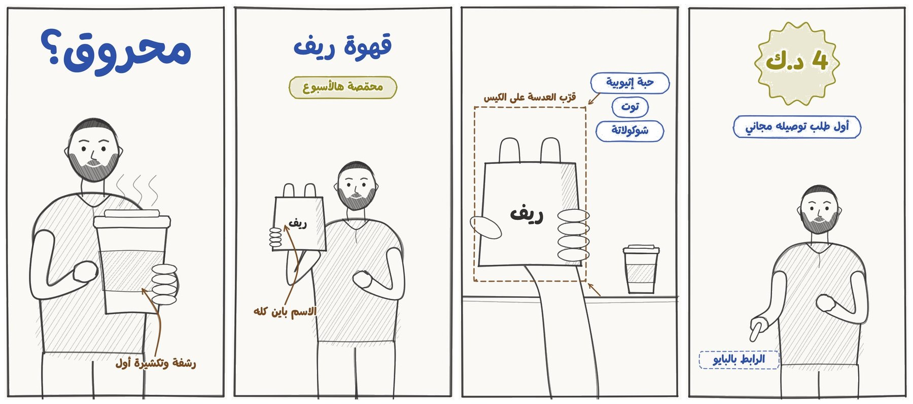
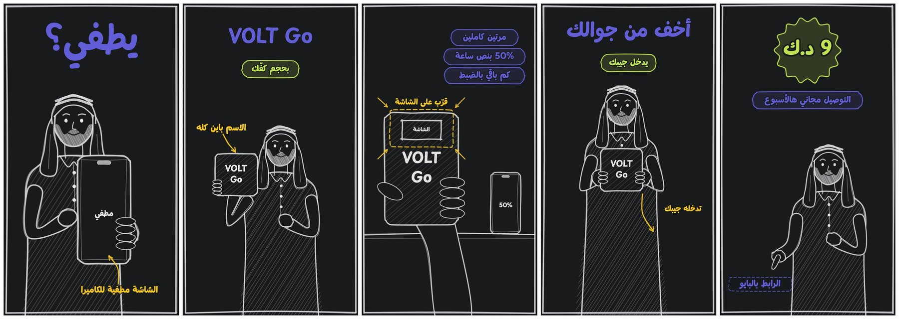
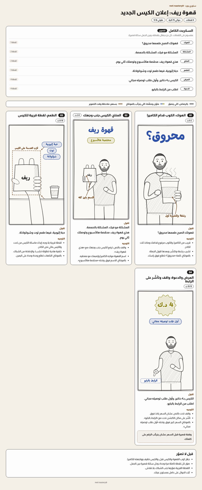

<div dir="rtl">

# ✍️ السكربت الإيقاعي + 🎬 ستوري بورد — مجاني

سكلين ورا بعض: الأول يكتب لك السكربت، والثاني يوريك شلون تصوّره.

## 1. السكربت الإيقاعي

يكتب لك سكربت ريل يمسك المشاهد لين آخر ثانية. السر مو الكاميرا ولا الإضاءة… **الإيقاع**.

- **26 صيغة هوك جاهزة** — كل وحدة معاها «هوك الشاشة» اللي ينكتب بأول فريم، وشلون تنخرب.
- **الاحتياجات الإنسانية الستة (توني روبنز):** كل هوك مبني على زناد واحد (الأمان، المفاجأة، الأهمية، الترابط، النمو، العطاء)، والطلب الأخير يخدم نفس الزناد.
- **قاعدة العشر ثواني:** ليد يعدّي المشاهد علامة 10 ثواني، ودورتين فضول ما فيهم لحظة «خلاص فهمت، أسكّر».
- **رموز إلقاء** (`[نبضة]` `[انفجار]` `...`) تقرأها وانت تصوّر — أو اطلب نسخة نظيفة بدونها.
- **نمط «يابنق»:** لما تبي تتكلم للكاميرا براحتك — نقاط بكلامك بلا هوك مصنوع.
- **بلهجتك:** الكويتية افتراضياً، ويكتب بأي لهجة تختارها.

## 2. ستوري بورد من السكربت

عندك سكربت إعلان أو ريل وما تدري شلون تصوّره؟ تعطيه السكربت (منه أو من عندك)، ويطلّع لك صفحة وحدة تفتحها بجوالك وقت التصوير.

- **السكربت مقسوم على اللقطات** — كل جملة عليها رقم لقطتها، وكلامك ما يتغيّر فيه ولا كلمة.
- **رسمة سكتش لكل لقطة** — بقلم رصاص، تبيّن وين توقف، شكبر المنتج بالكادر، والكتابة اللي تنركّب بالمونتاج.
- **«تقول» و«التوجيه»** — شنو تقول بكل لقطة، وين تقعد، وشنو تسوي بإيدك ومع أي كلمة.
- **«قبل لا تصوّر»** — شنو تجهّز قبل ما تفتح الكاميرا.
- **بهويتك** — ألوانك وخطك واسم حسابك، والشخصية المرسومة على شكلك: لحية، غترة، شماغ، حجاب، كاب، نظارة.
- **لأي نوع تصوير** — كلام للكاميرا، منتج بإيدك، لقطة قريبة، داخل السيارة، قدام المحل، وتسجيل شاشة.
- **بلا أي تنزيل** — يطلع ملف واحد ينفتح بأي جهاز.

### أمثلة من الرسمات

إعلان قهوة بأربع لقطات: الكوب قدام الكاميرا، الكيس جنب الوجه، لقطة قريبة، والعرض.

<p align="center"></p>

إعلان باور بانك بهوية غامقة وشخصية بغترة: الرسم يصير طباشير على لوح.

<p align="center"></p>

والصفحة كاملة تطلع كذا:

<p align="center"></p>

الأسماء اللي بالأمثلة خيالية.

## التثبيت

من **claude.ai** ← الإعدادات ← **Plugins** ← **Add marketplace** ← الصق:

```
majedphotos/majed-plugins
```

وبعدها أضف **majed-script**. (نفس المتجر حق بلقن الفيديو — لو مضيفه من قبل، أضف البلقن بس.)

أو من Claude Code بالطرفية:

```
/plugin install majed-script --marketplace majedphotos/majed-plugins
```

## الاستخدام

قل لكلود: «اكتب لي سكربت ريل عن …» — أو «سكربت يابنق عن …».

وبعدها: «سو لي ستوري بورد لهالسكربت». أو الصق أي سكربت عندك وقل «شلون أصور هالإعلان؟».

أول مرة يسألك الستوري بورد سؤال واحد عن ألوانك وخطك وشكلك، وبعدها يمشي.

</div>
