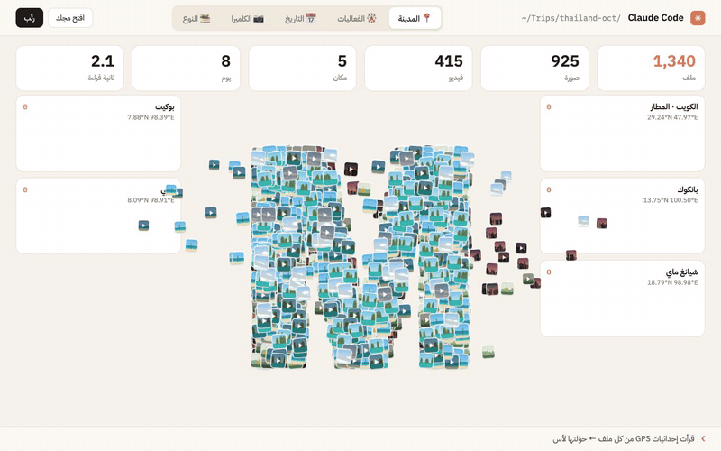
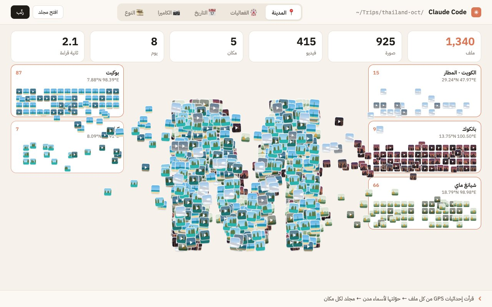
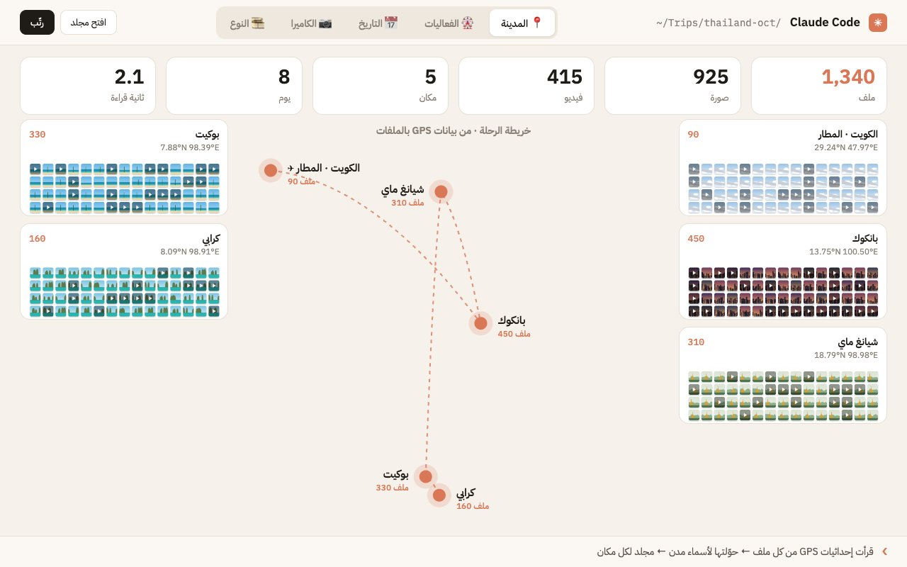

# مرتب الرحلات

قول لكلود: «رتب صور رحلتي لتايلند».

- يقرا الرحلة من تطبيق الصور بالماك. ياخذ اسم الملف والتاريخ واللوكيشن بس، وما يفتح ولا صورة.
- يجمع الصور اللي انخذت بنفس المكان ونفس الوقت كـ«فعالية»، ويطلب اسمها من خريطة أبل (حديقة حيوان، شاطئ، سوق…).
- يفتح شاشة متحركة الصور فيها تتجمع وتتوزع على المدن والأيام والفعاليات. الشكل الأساسي دائرة، وتقدر تطلب حرف أو كلمة بداله.
- إذا وافقت، يسوي مجلد ألبومات بتطبيق الصور (ألبوم لكل فعالية)، ويطلع بالآيفون عن طريق صور آي كلاود.

**يحتاج:** ماك وتطبيق الصور، و Python 3، و Xcode Command Line Tools عشان أسماء الأماكن.
**الخصوصية:** كل شي يصير على جهازك. والمربعات اللي على الشاشة رسومات، مو صورك.

## شكلها على الشاشة

| الصور تتجمع بحرف | خريطة الرحلة من الـGPS |
|---|---|
|  |  |

*الصور فوق من نسخة تجربة ببيانات وهمية.*
